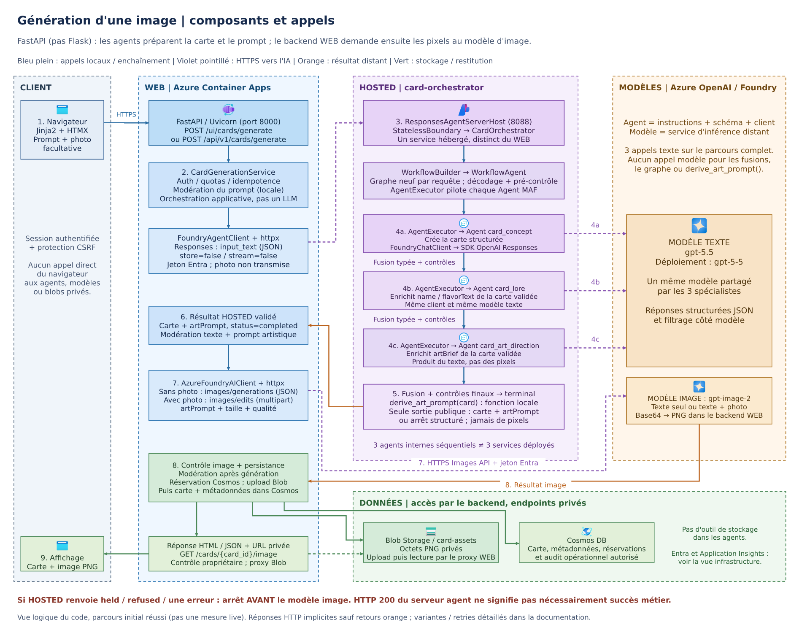
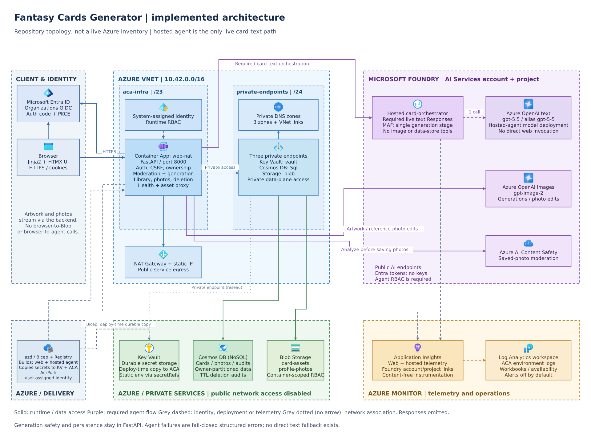

# Implemented architecture

[Editable source (two pages)](architecture.drawio) |
[Generation SVG](images/architecture.svg) | [Generation PNG](images/architecture.png) |
[Infrastructure SVG](images/architecture-overview.svg)

This diagram describes the current repository implementation and infrastructure
defaults, not a fresh inventory of live Azure resources. Historical deployment
records and proposed extensions are not evidence that a feature is enabled in
every environment.

## Image-generation call flow

The first draw.io page, **Generation image - appels et composants**, explains
the initial successful generation path. The web framework is **FastAPI, not
Flask**. A logical connection inside a service is not necessarily an HTTP call:
`CardGenerationService`, the MAF graph and deterministic safety/merge nodes are
Python code. An `Agent` combines instructions, a schema and a model client;
the model is the remote inference service.

| Step | Component / call | Source |
| --- | --- | --- |
| 1 | Browser submits a prompt and optional photo through HTTPS to `/ui/cards/generate`, or a client uses `/api/v1/cards/generate`. FastAPI authenticates and checks CSRF. | [`app/main.py`](../app/main.py), `ui_generate_card` / `api_generate_card` |
| 2 | `CardGenerationService` applies quotas, idempotency and local prompt moderation, then invokes `FoundryAgentClient`. | [`app/generation.py`](../app/generation.py), `generate_card` / `_run_generation` / `_generate_text` |
| 3 | `httpx` sends a nonstream, stateless Responses request to the Foundry agent endpoint using an Entra token. Its `input_text` contains the application JSON request; it does **not** contain the photo. `ResponsesAgentServerHost` and `StatelessBoundary` dispatch to `CardOrchestrator`. | [`app/foundry_agent_client.py`](../app/foundry_agent_client.py), `_invoke_without_outer_timeout` / `_build_responses_url`; [`server.py`](../hosted_agents/card_orchestrator/server.py), `create_host` |
| 4 | A fresh `WorkflowBuilder` graph, exposed as `WorkflowAgent`, runs one `generation` stage through a single `AgentExecutor`. That stage uses `Agent` + `FoundryChatClient` (agent name `card_generation`) and the configured text deployment. A typed merge and safety gates bracket the stage. | [`workflow.py`](../hosted_agents/card_orchestrator/workflow.py), `build_workflow`; [`specialists.py`](../hosted_agents/card_orchestrator/specialists.py), `FoundrySpecialists.agent` / `create_specialists` |
| 5 | The hosted runtime derives `artPrompt` locally from the validated card, closes resources, applies final checks and emits the terminal result. The successful result is text/JSON, not an image. | [`workflow.py`](../hosted_agents/card_orchestrator/workflow.py), `FinalTextAndArtSafety` / `TerminalEnvelope`; [`orchestrator.py`](../hosted_agents/card_orchestrator/orchestrator.py), `generate` |
| 6 | WEB validates the hosted result and moderates the card text and art prompt. It proceeds to image generation only after successful agent completion and these gates. | [`app/generation.py`](../app/generation.py), `_generate_text` / `_run_generation` |
| 7 | WEB's `AzureFoundryAIClient` calls `gpt-image-2` through `httpx`: JSON `images/generations` without a reference image, or multipart `images/edits` with one. It decodes the returned `b64_json` into PNG bytes. | [`app/generation.py`](../app/generation.py), `generate_image` / `generate_image_edit` / `_post` / `_post_multipart` |
| 8 | WEB moderates the generated image, obtains the Cosmos persistence reservation, uploads the PNG to Blob Storage, then saves the card and permitted operational metadata in Cosmos DB. | [`app/generation.py`](../app/generation.py), `_run_generation` / `_persist_completed` |
| 9 | WEB returns HTML or JSON with the image URL. A subsequent `GET /cards/{card_id}/image` checks ownership and proxies private Blob bytes to the browser. | [`app/main.py`](../app/main.py), `card_image`; [`app/generation.py`](../app/generation.py), `fetch_image` |

Under the approved #168 single-call contract the text path makes one generation
model call. The graph, typed merge, moderation gates and `derive_art_prompt()`
do not make additional LLM calls. The evidence stages are `pre_prompt`,
`generation`, `final_text` and `final_art_prompt`. The text default is model
`gpt-5.5`, deployment alias `gpt-5-5`; the image default is `gpt-image-2`
([`infra/main.bicep`](../infra/main.bicep)). These are repository configuration
defaults, not a fresh live-resource query. The earlier concept/lore/art-direction
chain is historical #164 design context, not current runtime behaviour.

The diagram groups the deterministic merge/gate nodes for readability; it does
not omit them from execution. **One internal Agent is not a separately deployed
service.** There is one hosted orchestrator, separate from the WEB
Container App, and it has no image-generation or data-store tools.

### HTTP boundaries and alternative outcomes

WEB calls the project endpoint
`/agents/{agent-name}/endpoint/protocols/openai/responses`.
The generation stage calls the text model through `FoundryChatClient`,
`AIProjectClient` and the OpenAI Responses SDK; it does not call the hosted
orchestrator again.
The WEB image calls use
`/openai/deployments/{image-deployment}/images/generations` or `images/edits`.
Diagram arrows identify the logical caller and callee; response legs are
implicit except for the orange hosted-result and image-result arrows.

`held`, `refused`, routing deferral or a runtime failure stops the initial
pipeline **before** the image-model call. A hosted HTTP 200 can carry a `held`
business result; WEB can map that to `502 / invalid_model_output`.
Content-free completion diagnostics explain the failed checker, not necessarily
the underlying provider cause. See [the invocation contract](foundry-agent-invocation.md).

Without a reference photo, an image-service failure may yield a persisted
text-only partial card; artwork retry follows a separate image-only path. A
reference-photo edit failure instead returns an error. Existing image retries,
duplicate-request replay and failure audits are not expanded into separate
arrows. Saving a new reference photo can also invoke Azure AI Content Safety
before this path; loading a saved photo uses Blob Storage. Photos remain
WEB-owned and are not sent to the hosted generation stage.

## Infrastructure overview

The second draw.io page retains the broader infrastructure view, including
Entra ID, networking, deployment, private endpoints and Application Insights.

## Runtime boundaries

The public application is one FastAPI Container App (`web-nat` in `azure.yaml`),
serving Jinja2/HTMX pages and JSON APIs on port 8000 behind HTTPS ingress. The
browser authenticates with Microsoft Entra ID's multi-tenant `organizations`
OIDC flow; the backend performs authorization-code exchange with PKCE, maintains
the signed session, and enforces CSRF and owner-scoped access.

`CardGenerationService` keeps rate limiting, idempotency, deterministic moderation,
image calls, artwork retry semantics, and persistence in the web application.
Same-instance duplicate generation is coalesced in memory while refusal-capable
processing runs without durable request metadata. Cosmos card/retry reservations
are acquired only after applicable moderation allows, immediately before safe
completed/partial persistence.
Every live text request invokes the separately deployed `card-orchestrator`
through the Foundry project's Responses endpoint. Current #168 migration scope
uses one generation-stage agent request and one model dependency call per
invocation. `ResponsesAgentServerHost`, pinned dependencies, and the stateless,
nonstream Responses API remain unchanged.

Approved [#164 r1](https://github.com/bmoussaud/fantasy-cards-generator/issues/164#issuecomment-5775375929)
workflow details remain documented as historical design and acceptance context,
but are superseded for current runtime behavior by the approved #168 single-call
contract. Historical #164 evidence is not rewritten as #168 runtime evidence, and
#168 does not claim measured quality/cost/latency benefit.
The last recorded dev deployment remains hosted v9 at `7d68e4e`;
historical #162 evidence does not validate the new graph.

The agent receives text, not uploaded photos, user/session credentials, or
data-store access tools. There is no direct card-text implementation or
automatic fallback: all agent failures use bounded, content-free structured
errors. Images still use the web backend's `gpt-image-2`
generation or reference-photo edit calls. Saved-photo uploads additionally use
Azure AI Content Safety; this is distinct from the generation pipeline's
heuristic moderation and model-side content filtering.

Cards, saved-photo metadata, operational generation audits, and deletion audits
share Cosmos DB. Policy refusals persist none of those generation records or
artwork blobs. Artwork and saved photos/thumbnails use the `card-assets` and
`profile-photos` Blob containers. The backend streams image bytes after
ownership checks; browsers do not fetch private blobs directly. Card/account
deletion removes retained operational generation audits, keeps only the
documented TTL-limited deletion audits, and schedules blob cleanup in FastAPI
background tasks, not an external queue or worker service.

## Network, identity, and operations

The VNet contains a delegated `aca-infra` subnet (`10.42.0.0/23`) for a
workload-profile Container Apps environment and a `private-endpoints` subnet
(`10.42.2.0/24`). NAT Gateway plus a static IP provides public-service egress,
not private-service access. The diagram shows logical service dependencies
separately from this egress mechanism; it does not imply that public AI calls
bypass the subnet's NAT.

Three private endpoints connect to Cosmos (`Sql`), Storage (`blob`), and Key
Vault (`vault`). Their private DNS zones are `privatelink.documents.azure.com`,
`privatelink.blob.core.windows.net`, and `privatelink.vaultcore.azure.net` in
public Azure, each linked to the VNet. The backing services are shown outside
the subnet because the private endpoint network interfaces, not the PaaS
services themselves, reside there. All three services disable public network
access. Legacy Cosmos IP-rule parameters remain in Bicep but do not enable a
public access path.

The Container App's system-assigned identity gets Cosmos data-contributor
access scoped to the shared container, Blob data-contributor access scoped to
each asset container, and Cognitive Services User on the Foundry account. A
separate user-assigned identity has `AcrPull`. Session-signing and Entra client
secrets are stored as ACA-native secrets and exposed to the application through
`secretRef` environment variables.

Foundry's AI Services account and project use public endpoints and Entra tokens
with local key authentication disabled. The app receives project-scoped Foundry
Agent Consumer and the project identity receives Foundry User access as mandatory
agent-only prerequisites. Application startup validates local configuration and
mandatory telemetry, while dependency readiness (`/healthz`) validates the exact
configured active agent version with a bounded probe after the server listens.
Process startup and liveness use dependency-free `/livez`, so a Foundry outage
cannot cause restart loops.
The root `azure.yaml` declares both `web-nat` and `card-orchestrator`.
Its custom `azd up` workflow provisions shared resources, deploys the hosted
agent, re-provisions the exact version binding, then packages and deploys WEB.
Additional hosted-agent operational tooling lives under `deployments/card-orchestrator/`.

Web/hosted instrumentation uses Application Insights, linked to a Log Analytics
workspace. The ACA environment also sends logs to that workspace. Foundry
account/project App Insights connections are provisioned. Operational resources
include availability monitoring and workbooks; alert rules default to disabled.
The drawing omits individual RBAC resources and alert objects for readability.

## Source evidence

| Diagram surface | Authoritative repository inputs |
| --- | --- |
| Web, UI, auth, image proxy | `azure.yaml`, `Dockerfile`, `app/main.py`, `app/auth.py`, `app/library.py` |
| Agent-only generation and image models | `app/generation.py`, `app/foundry_agent_client.py`, `app/settings.py` |
| Hosted Responses boundary and specialists | `hosted_agents/card_orchestrator/server.py`, `orchestrator.py`, `specialists.py`, `settings.py` in that same directory |
| Saved photos and deletion | `app/photos.py`, `app/deletion.py` |
| VNet, NAT, ACA environment | `infra/modules/network.bicep`, `container-apps-environment.bicep`, `container-apps.bicep` |
| Private services and DNS | `infra/modules/cosmos-db.bicep`, `cosmos-private-endpoint.bicep`, `storage.bicep`, `security.bicep`, `keyvault-private-endpoint.bicep` |
| Identity, Foundry account/project/model deployments | `infra/main.bicep`, `infra/modules/ai-foundry.bicep`, `container-registry.bicep`, `security.bicep`, `container-apps.bicep` |
| Observability | `app/telemetry.py`, `app/health.py`, `infra/modules/monitoring.bicep`, `operational-monitoring.bicep` |

## Maintaining the assets

`architecture.drawio` is the sole diagram source for both pages: labels, domain membership,
component coordinates, official icon URLs, edge anchors, and orthogonal
waypoints are all stored in its uncompressed mxGraph XML. Edit this file in
diagrams.net, then regenerate both SVG/PNG pairs using the
[`architecture-diagram-author` skill](../.github/skills/architecture-diagram-author/SKILL.md).
Do not hand-edit generated images. Export `image-generation` to
`images/architecture.svg` and `images/architecture.png`, and
`implemented-architecture` to `images/architecture-overview.svg` and
`images/architecture-overview.png`. PNGs are rasterized from their generated
SVGs at 1,920 pixels wide. All icons originate from the official
[Microsoft icon collection](https://aka.ms/MsiconsCollections); their contents
are inlined in SVG with per-instance identifiers, not external image references.
The disposable rendering tool is not an application dependency.

The scoped renderer uses Node, `@xmldom/xmldom`, and `@resvg/resvg-js` from a
temporary session directory, not application dependencies. It decodes XML
numeric entities, resolves nested group coordinates, treats omitted coordinates
as zero and reconstructs orthogonal bends. Arrow markers use `orient="auto"`.

When regenerating, inspect the PNG as well as checking XML, local SVG
references, domain gutters (at least 80 px), line/box and line/title collisions,
and perpendicular terminal approaches of at least 15 px. Long edges use
separate upper/lower and inter-container lanes; lower domain headings sit at
the bottom to keep incoming arrows clear of titles.

No slide deck or video deck assets exist in this repository at the time of this
update, so deck synchronization is not applicable.
